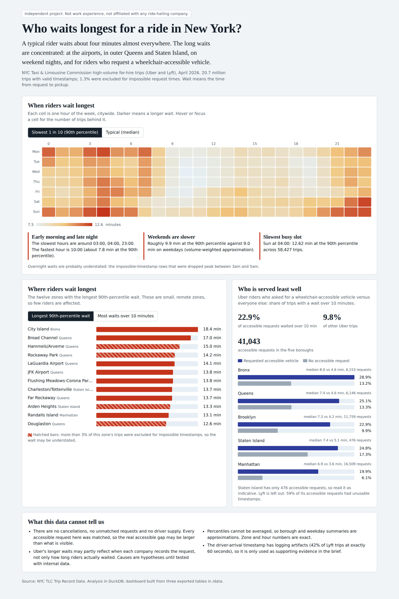

# Who waits longest for a ride in New York?

**Independent project.** This is a personal analysis of public data. It is not work experience and is not affiliated with Uber, Lyft or any employer.

A product-ops style case study on the NYC Taxi & Limousine Commission (TLC) high-volume for-hire vehicle trip records (Uber and Lyft), April 2026: about 21 million trips.

**Question:** where and when do riders wait longest, and which groups are least well served?

## Findings

- Median waits are similar (Uber 4.1 min, Lyft 3.9), but the tail differs: 90th percentile 10.0 vs 7.5 minutes, and 9.8% vs 3.7% of trips wait over 10 minutes. Compared within the same pickup zone, hour and day type, Uber's tail is longer in 95% of 7,354 comparable cells (2.6 minutes on average). This may partly reflect when each company records the request.
- On Uber, riders who requested a wheelchair-accessible vehicle have a median wait of 7.3 min vs 4.1, and 22.9% wait over 10 minutes vs 9.8%. The gap appears in all five boroughs.
- LaGuardia and JFK are 3.5% of trips but about 10% of waits over 10 minutes.
- Waits are longest at 3 to 5am, on weekend nights, and in outer Queens and Staten Island.

The one-page write-up is in [`brief.md`](brief.md), also available as a print-ready [PDF](Rider-wait_brief.pdf).

## Limits

- No cancellations, unmatched requests, driver supply or support tickets, so causes are hypotheses. Every accessible request in the data was matched, so unmet demand is invisible.
- About 1.3% of trips have a request time later than the driver's arrival (impossible). They cluster in early-morning hours and outer zones and affect 59% of Lyft accessible requests. They are excluded; Lyft accessible results are not reported; overnight waits are probably understated. A sensitivity check that keeps those rows (waits set to zero) leaves the headline results essentially unchanged for Uber.
- The driver-arrival timestamp shows logging artifacts (42% of Lyft trips at exactly 60 s), so it is used only as supporting evidence.
- Percentiles cannot be averaged. Borough and weekday summaries use trip-weighted averages of zone or hour percentiles and are approximate.

## Repository contents

| Path | What it is |
|---|---|
| `sql/hvfhv_analysis.sql` | Full DuckDB analysis: load, data quality, percentiles, zone and hour tables, accessibility analysis, export |
| `data/` | The three result tables exported from DuckDB (`wait_by_zone`, `wait_by_hour_dow`, `wav_by_borough_uber`) |
| `dashboard.html` | Interactive one-page dashboard (open in a browser; no dependencies) |
| `powerbi_build_guide.md` | How to rebuild the page in Power BI from the CSVs |
| `brief.md` | One-page product ops brief |
| `Rider-wait_brief.pdf` | The same brief as a print-ready one-page PDF |

## Reproduce it

1. Download `fhvhv_tripdata_2026-04.parquet` and `taxi_zone_lookup.csv` from the TLC Trip Record Data page.
2. In Google Colab (or the DuckDB CLI): `pip install duckdb jupysql duckdb-engine`, create `data/` and `out/` folders, then `%load_ext sql` and `%sql duckdb:///hvfhv.duckdb`.
3. Run the statements in `sql/hvfhv_analysis.sql` one at a time. Note DuckDB cannot combine `QUALIFY` with `GROUP BY ALL`.

## Data

NYC TLC Trip Record Data, public. The raw files are large and not included here.
